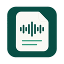

<p align="center">
  
</p>

<h1 align="center">Voxly</h1>
<p align="center"><strong>Turn recordings into text. Keep your workspace on your Mac.</strong></p>
<p align="center">A place to transcribe, revisit and organize interviews, meetings and long recordings.</p>

<p align="center">
  <a href="https://github.com/SkyBridgeM/voxly/releases/tag/v0.1.0-alpha"></a>
  
  <a href="LICENSE"></a>
</p>

<p align="center">
  <a href="https://github.com/SkyBridgeM/voxly/releases/tag/v0.1.0-alpha">Download for Mac</a> ·
  <a href="#your-first-transcript">Get started</a> ·
  <a href="desktop/README.md">Developer guide</a> ·
  <a href="README.md">简体中文</a>
</p>

---

An hour-long interview is easy to record and slow to search by ear. Voxly turns it into readable text, splits speech around pauses and keeps the results in a Task Library. You can generate notes afterward, resume interrupted work, or clear a task's audio once you have checked its transcript.

Choose SenseVoice for recognition on your Mac or MiMo for cloud transcription. Whether audio or text leaves your device depends on the features you select.

## What you can do

| | In practice |
| --- | --- |
| **Transcribe locally** | Run SenseVoice without a transcription API key. Chinese is the default; automatic language detection is also available. |
| **Split around speech pauses** | Optional VAD detects speech intervals and produces timed segments. Longer speech intervals are split further. |
| **Resume long recordings** | Save progress by segment and reuse completed checkpoints after an interruption. |
| **Generate notes** | Use DeepSeek templates for summaries, meeting notes and action items, with saved generation versions. |
| **Keep tasks together** | Browse transcripts and generated results in the Task Library. Each task has its own folder. |
| **Keep text, clear audio** | Preview disk usage, then remove a task's audio copy and chunks while retaining text, timing data and generated content. |
| **Import M4A directly** | M4A, MP3 and WAV are supported. FFmpeg is bundled, so you do not need to convert files yourself. |

> Version `0.1.0-alpha` is an early release for Apple Silicon Macs. It has no Apple Developer ID signature or notarization.

## Download and install

**[Get the DMG from Releases →](https://github.com/SkyBridgeM/voxly/releases/tag/v0.1.0-alpha)**

Open `Voxly_0.1.0-alpha_macos_arm64.dmg` and drag Voxly into Applications. The app includes FFmpeg 9.0.2, the Go core and the native recognition runtime. Users do not need Homebrew, Python or Go.

- **Install the model separately.** Download or import SenseVoice in the app. The download is about 156 MiB; weights are not included in the DMG.
- **macOS may block this test build.** Check the download source and release SHA-256 values. If opening is blocked, review the message under macOS System Settings → Privacy & Security.
- **Current distribution:** Apple Silicon only. There is no Intel Mac or Windows installer, and installation on a separate clean Mac still needs validation.

## Your first transcript

1. **Install SenseVoice.** Open Settings → Models & connections, then download or import the model.
2. **Choose local recognition.** Under transcription settings, keep Chinese for Chinese recordings or select automatic detection for multilingual audio.
3. **Set segmentation.** Enable VAD to split around speech pauses, then save. New tasks use the new settings; resumed tasks retain their language and segment plan.
4. **Import and start.** Choose an M4A, MP3 or WAV file and start transcription. Open the result in the Task Library.

For a plain transcript, transcription alone is enough. To organize it further, configure DeepSeek credentials and choose a generation template.

## Long recordings, less disk usage

Each task stores an audio copy, processing state, transcript and generated content. VAD tasks also retain a timed transcript and segment JSON. Times describe speech intervals, not individual words.

Settings → Storage shows usage and offers batch chunk cleanup. Automatic chunk cleanup is off by default. Enabling it applies to tasks that finish successfully afterward; interrupted and failed tasks keep their audio so they can continue.

**After checking the transcript, choose Task Library → Task details → Audio & cache → Keep text only.** Review the file list and estimated reclaimed space before confirming. Voxly removes the task's audio copy and chunks, keeping the transcript, timing results, generation versions and task metadata.

The external file you imported stays untouched. Full audio removal is a manual action, separate from automatic chunk cleanup. Keep text only cannot be undone; retain a separate recording if you need playback or another recognition pass.

## Where your data goes

| Feature | Processing and uploads |
| --- | --- |
| **Local SenseVoice transcription** | Runs on your Mac without audio uploads or an API key. The initial model download needs internet access. |
| **MiMo cloud recognition** | Sends audio to MiMo. Credentials required. |
| **DeepSeek content generation** | Sends transcript text to DeepSeek. Credentials required. |

Choosing cloud generation after local transcription still sends text off-device. Release builds read credentials from the current session or OS secure store, never the repository's `.env` file.

## Current limits

- Works with existing recordings; no desktop microphone capture or streaming recognition yet.
- Speaker diarization is not implemented. CAM++ has a reserved code interface only.
- Names, technical terms and short replies can be misrecognized. Check important passages.

Local sample transcription and package dependency checks have passed. See the [release notes](docs/releases/0.1.0-alpha.en.md) for this Alpha's scope and limitations.

## Run from source

The desktop uses **Tauri + React + Go**, with a native sherpa-onnx adapter for local recognition. Install Node.js/npm, Rust, Go, Python 3.11+ for build tooling, and Xcode Command Line Tools. From the repository root:

```bash
npm --prefix desktop ci
./scripts/build_desktop_sidecar.sh
go build -C core-go -o meeting-asr-go .
npm --prefix desktop run tauri -- dev
```

The first build downloads pinned native dependencies and FFmpeg sources. Install SenseVoice through the app. Use `./scripts/build_macos_release.sh` to prepare an installer; it does not commit, push or publish.

| Looking for | Documentation |
| --- | --- |
| Desktop development, checks and packaging | [Desktop guide](desktop/README.md) |
| CLI and processing runtime | [Go core](core-go/README.md) |
| Model installation and runtime contracts | [Local model management](docs/architecture/local-model-management.md) |
| The former Python implementation | [Retirement notes](docs/legacy-python.md) |

Issues and contributions are welcome. Include the app version, macOS version, reproduction steps and redacted logs when reporting a problem. Leave out API keys and private recordings. Dated plans and audits describe earlier work; use this README and release notes for current functionality.

## License and credits

Voxly's own code is available under the **[MIT License](LICENSE)**. Third-party components and models retain their respective licenses.

Voxly builds on SenseVoice, sherpa-onnx, Silero VAD, FFmpeg, Tauri, React and Go. See [THIRD-PARTY-NOTICES](native/THIRD-PARTY-NOTICES.md) for dependency notices. Release packages include the relevant notices; matching FFmpeg/LAME sources and build instructions accompany the release.
