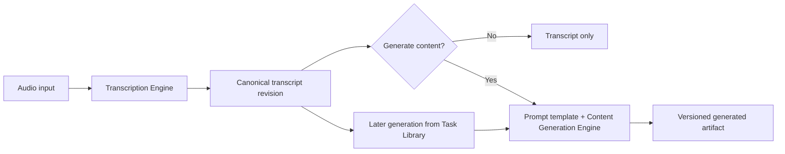

# Future Processing Architecture

Status: proposed architecture for incremental implementation  
Scope: processing contracts, artifacts, and migration boundaries  
Current implementation: remains unchanged by this document

## 1. Purpose and invariants

This document defines the target architecture for transcription and prompt-driven content generation. It is implementation-oriented: future changes should use these contracts and preserve the invariants below, while migrating incrementally from the current Transcript, Notes, and Minutes modes.

The core invariants are:

- A Task represents one audio-processing workflow and its related outputs.
- `transcript.md` is the provider-neutral, canonical user-facing transcript.
- Generated content is derived from a specific transcript revision through a prompt template and an LLM provider.
- ASR and LLM providers are separate domains and can be selected independently.
- Provider hard limits are always enforced.
- Chunk planning is explicit and deterministic; chunking is visible to the runtime, not to the reader.
- Repeated generation never overwrites or automatically deletes an earlier generation.
- Credentials never enter TaskManifest, task folders, generated artifacts, or logs.
- TaskManifest remains the filesystem source of truth. Any evolution is additive, versioned, and non-destructive.

## 2. Current state and target product model

### 2.1 Current compatibility model

The current desktop product exposes Transcript, Notes, and Minutes as top-level modes. Existing behavior and artifacts must remain readable while migration is in progress. The first structural refactors should preserve current Mimo chunking and provider behavior unless a PR explicitly changes and tests that behavior.

### 2.2 Target product model

The future top-level choices are:

1. **Transcript only**
2. **Transcript + generated content**

Notes and Meeting Minutes are not permanent processing primitives. They become prompt-template choices within generated content.



### 2.3 Transcript

A transcript is a faithful canonical transcription of the source audio:

- no LLM rewriting or summarization;
- no internal chunk markers, filenames, or provider debug headers;
- stable user-facing content independent of provider chunking behavior;
- only necessary whitespace normalization during chunk merge;
- no fabricated speakers or timestamps;
- real provider timestamps or speaker labels may be retained when available and represented explicitly.

### 2.4 Generated content

Generated content:

- derives from an existing canonical transcript revision;
- uses a prompt template and an independently selected LLM provider;
- may run during initial Task processing or later from Task Library;
- never requires audio upload or ASR rerun when a valid transcript already exists;
- never rewrites the source transcript;
- is stored as a versioned derived artifact.

The initial UI may permit one selected template per run. The data model must support multiple templates and multiple generations per template within one Task.

## 3. Processing stages and ownership

ASR execution and generated-content execution are separate stages with separate status and retry semantics.

| Stage | Input | Owner | Output |
| --- | --- | --- | --- |
| Audio inspection | source audio reference | runtime/media inspector | inspected metadata |
| Chunk planning | metadata, ASR capabilities, strategy, constraints | Chunk Planner | deterministic chunk plan |
| Transcription | audio or planned chunks | ASR provider adapter | provider results |
| Canonical merge | provider results and chunk plan | transcript assembler | canonical transcript revision |
| Content generation | transcript revision and template snapshot | LLM generation runtime | versioned generated artifact |

Provider adapters execute provider-specific requests and normalize responses. They do not make product-mode decisions, select templates, or silently override planner output.

## 4. Prompt templates

### 4.1 Initial built-in templates

The first built-in templates are:

| Stable ID example | User-facing name | Purpose |
| --- | --- | --- |
| `structured-notes` | Structured Notes | Organize key topics and supporting detail |
| `meeting-minutes` | Meeting Minutes | Produce conventional meeting minutes |
| `action-items` | Action Items | Extract actionable work, owners when stated, and deadlines when stated |
| `content-summary` | Content Summary | Summarize the source content without meeting-specific assumptions |

The exact stable ID registry should be finalized with schema fixtures before implementation. Display names may be localized; IDs must not depend on display text.

Meeting Minutes is one built-in prompt template, not a runtime mode.

### 4.2 Built-in and custom behavior

- Built-in templates have stable IDs and revisions.
- Built-in templates cannot be directly edited or deleted.
- A user may duplicate a built-in template into a new custom template.
- A custom template has a user-facing name and processing instructions.
- The first UI does not require users to insert `{{transcript}}` manually.
- The runtime combines system integrity instructions, effective template instructions, and transcript content in a defined order.
- Future variable expansion may be added through a versioned contract; it is not required initially.

The runtime must clearly delimit trusted system instructions, template instructions, and transcript data. Transcript content is data and must not silently become system-level instruction.

### 4.3 Identity, revision, and snapshot

Each template has at least:

- `template_id`: stable identity;
- `template_kind`: `built_in` or `custom`;
- `template_revision`: immutable revision identity;
- user-facing name;
- normalized processing instructions.

Editing instructions creates a new revision. Renaming may update user-facing metadata without changing instruction meaning, but every generation still records the effective name and instructions used.

Each generation records a snapshot sufficient to explain historical output:

- template ID, kind, and revision;
- effective user-facing template name;
- normalized template instructions;
- effective system-instruction revision;
- prompt composition version;
- prompt hash over the normalized effective prompt inputs;
- optionally the full non-secret prompt snapshot when privacy and storage policy permit.

The recommended initial design stores normalized template instructions plus IDs, revisions, composition version, and hash. Whether to retain the full composed prompt is an unresolved privacy/storage decision. Credentials, authorization data, and secret-bearing endpoint configuration are never included.

## 5. Transcript contract and revisions

### 5.1 Canonical transcript

`transcript.md` is the canonical, provider-neutral transcript artifact. Its contract is:

- faithful text in source order;
- no `[part 001]`, `[part 002]`, or similar runtime markers;
- no provider debug headers;
- no chunk filenames or temporary paths;
- no LLM summary, cleanup rewrite, or invented content;
- chunk boundaries are invisible unless they coincide with meaningful transcript structure;
- only necessary whitespace normalization at merge boundaries;
- provider-supplied timestamps and speaker labels are allowed only when truly available and represented by an explicit transcript format contract.

The implementation must not remove part markers afterward with a broad regular expression. The merge path should never insert internal markers into the canonical artifact.

Internal chunk identity belongs in the chunk plan, TaskManifest execution metadata, logs, intermediate artifacts, and failure diagnostics.

> Chunking is visible to the runtime, not to the reader.

### 5.2 Transcript revision model

The canonical transcript has a stable artifact identity and immutable revisions. A transcript revision should include:

- `transcript_id`: stable identity within the Task;
- `revision_id`: immutable revision identity;
- `content_hash`: hash of canonical content bytes under a specified normalization/version;
- `created_at` and, where applicable, `superseded_at`;
- safe relative artifact reference;
- provenance identifying the ASR run or later user correction;
- completion/integrity status.

The current `transcript.md` path may remain the emphasized latest artifact during migration, but historical revision storage must not depend on repeatedly overwriting that file without preserving identity. Exact physical layout is deferred to implementation fixtures.

Every generated artifact records the source transcript revision ID and content hash. This allows future transcript correction to coexist with historical generations and lets regeneration intentionally target the latest or a selected revision.

A valid generation source is a completed canonical transcript revision whose artifact exists, passes containment validation, and whose content hash matches recorded metadata. Incomplete or corrupted transcript revisions are not valid sources unless a future explicit partial-transcript workflow defines otherwise.

Transcript editing is not implemented by this architecture PR.

## 6. Versioned generated artifacts

### 6.1 Generation record

Each generation is an append-only logical record containing at least:

| Field | Meaning |
| --- | --- |
| `generation_id` | Stable identity for this requested generation |
| `template_id` / `template_revision` | Effective template identity |
| `created_at` / `updated_at` | Lifecycle timestamps |
| `source_transcript_revision` | Immutable transcript revision identity |
| `source_transcript_hash` | Integrity link to canonical content |
| `llm_provider_id` / `llm_model` | Generation provider snapshot |
| `prompt_composition_version` | Runtime prompt assembly contract |
| `prompt_snapshot` or normalized instructions + `prompt_hash` | Historical explainability |
| `artifact_reference` | Safe relative reference when completed |
| `status` | Lifecycle state |
| `error_summary` | Structured safe failure information when applicable |

Generated artifact references remain relative to the validated Task folder. Display names are not filesystem identities.

### 6.2 Repeated generation

Running the same template repeatedly against the same transcript:

- creates a new generation identity;
- never overwrites an earlier completed output;
- retains failed-attempt diagnostics;
- never automatically deletes historical versions.

The recommended retry model keeps a stable `generation_id` for one user-requested generation and records numbered attempts beneath it. A retry of a failed attempt may update that generation to completed while preserving prior attempt diagnostics. A deliberate “generate again” action creates a new `generation_id` and therefore a new visible version. This distinguishes transport retry from user-requested regeneration.

Failed attempts must not expose a misleading completed artifact reference.

### 6.3 Conceptual artifact layout

```text
generated/
  meeting-minutes/
    <generation-id>.md
  action-items/
    <generation-id>.md
```

This is a conceptual layout, not a finalized filename contract. Implementation must use safe generated identifiers rather than display names alone, reject traversal and platform prefixes, avoid reserved filenames, define length limits, and preserve extension/content-type consistency. Timestamps may aid readability but must not be the only identity source.

Task Library may emphasize the latest successful generation for each template while retaining access to older successful and failed versions.

## 7. Post-transcription generation

The required future flow is:

```text
Existing completed canonical transcript revision
  -> select prompt template
  -> select Content Generation Engine and model
  -> create generation record
  -> run LLM generation
  -> append a derived-artifact version
```

This flow must not:

- re-upload source audio;
- rerun ASR;
- rewrite the canonical transcript;
- replace previous generated versions.

Before generation, the runtime validates the transcript revision, template revision, provider configuration, token/input limits, and Task-folder containment. The generation record captures these effective inputs before provider execution.

## 8. Separate provider domains

### 8.1 Transcription Engine (ASR provider)

An ASR provider converts audio into transcript data. It may impose duration, file-size, format, chunking, concurrency, and rate limits, and may offer timestamps, speaker diarization, language detection, or streaming.

### 8.2 Content Generation Engine (LLM provider)

An LLM provider converts a transcript plus effective template instructions into generated content. It has independent credentials, endpoint policy, model selection, token limits, retry behavior, and capabilities.

The UI should not present one unified provider dropdown. User-facing labels should be **Transcription Engine** and **Content Generation Engine**. Internal code may use provider IDs and interfaces.

Supported architecture examples include:

- Mimo ASR + DeepSeek LLM;
- Local Whisper + Ollama;
- cloud ASR + an OpenAI-compatible LLM.

Local and cloud implementations must satisfy the same domain contracts without assuming identical credential, endpoint, or chunk behavior.

## 9. ASR provider capability contract

Each provider/model capability snapshot should express:

| Capability | Type | Classification |
| --- | --- | --- |
| `capability_contract_version` | version | contract identity |
| `provider_id`, `model_id` | stable IDs | identity |
| `maximum_duration` | optional duration | hard limit |
| `maximum_file_size` | optional bytes | hard limit |
| `accepted_formats` | normalized format set | hard limit |
| `requires_chunking` | condition/capability | hard rule |
| `supports_unchunked_input` | boolean/condition | hard capability |
| `recommended_chunk_duration` | duration | default |
| `maximum_chunk_duration` | duration | hard limit |
| `recommended_overlap` | duration | default |
| `supported_concurrency` | range | hard limit/default |
| rate-limit and retry hints | structured hints | recommendation unless provider-mandated |
| timestamp support | capability enum | feature |
| speaker-diarization support | capability enum | feature |
| language support | languages/detection modes | feature/hard support boundary |

Capabilities may depend on provider, model, endpoint class, account tier, and capability-contract version. The effective capability snapshot used by a run is recorded so historical planning remains explainable.

Three categories must remain distinct:

1. **Hard provider limits** — cannot be bypassed by user configuration.
2. **Recommended defaults** — selected by Auto and overridable within hard limits.
3. **User preferences** — optional choices validated against the effective capability snapshot.

The contract must not assume Mimo-specific limits or response formats.

## 10. Chunk Planner

Chunk Planner is a runtime component separate from the ASR provider adapter.

### 10.1 Inputs

- inspected audio metadata, including duration, size, format, and stream properties;
- selected provider/model and effective capability snapshot;
- user chunk strategy and allowed preferences;
- runtime constraints such as available concurrency or temporary storage.

### 10.2 Output

A deterministic chunk plan containing:

- plan ID and planner-contract version;
- source metadata hash or identity;
- ordered chunk boundaries;
- overlap per boundary;
- effective concurrency;
- reason for chunking;
- hard-limit validation result;
- normalized provider/model capability snapshot reference;
- warnings when preferences were adjusted or rejected.

Given the same normalized inputs and planner version, the plan should be reproducible.

### 10.3 Strategies

- `provider_auto`: default for normal UI; planner selects safe provider-aware values.
- `unchunked`: one provider request, available only when capabilities and source metadata permit it.
- `custom`: advanced user preferences for duration, overlap, and concurrency.

Rules:

- `unchunked` is unavailable when hard limits require chunking.
- Custom values are rejected or explicitly clamped according to a documented policy; they are never allowed to exceed hard limits silently.
- The effective plan records requested and effective values when adjustment occurs.
- Normal UI defaults to Auto.
- Advanced settings may later expose duration, overlap, and concurrency.
- The first refactor extracts planner structure while preserving current Mimo behavior exactly. Behavioral tuning follows in separately reviewed changes.

## 11. Failure and retry semantics

Failures are stage-specific and do not erase successful upstream artifacts.

### 11.1 ASR failures

- audio inspection failed;
- chunk planning failed;
- individual chunk failed;
- transcript merge failed;
- canonical transcript incomplete or unavailable.

Chunk-level failures retain chunk identity and structured retryability in execution metadata. A canonical transcript is completed only when the transcript integrity contract is satisfied. A future explicit partial-transcript artifact, if introduced, must not masquerade as a completed canonical transcript.

### 11.2 Generation failures

- transcript unavailable or integrity validation failed;
- template or template revision unavailable;
- LLM provider unavailable;
- generation request failed;
- generated artifact write failed.

A generation failure never invalidates an already completed transcript. Retryable provider/transport failures use a new attempt under the same generation identity. A user-requested regeneration creates a new generation version. Failed diagnostics remain structured and safe, and no completed artifact reference is emitted until the file write succeeds.

## 12. Manifest evolution

This document does not modify the current TaskManifest schema. Future schema versions should add snapshots similar to the following.

### 12.1 ASR run snapshot

- provider and model IDs;
- capability-contract version and snapshot reference;
- chunk strategy and planner version;
- chunk count, duration, overlap, and concurrency;
- plan reference and reason for chunking;
- transcript identity, revision, and content hash;
- stage and chunk-level statuses/errors.

### 12.2 Generation snapshot

- generation ID and attempt history;
- template ID, kind, and revision;
- normalized instructions and prompt hash/snapshot policy;
- prompt-composition version;
- LLM provider and model IDs;
- source transcript revision and hash;
- safe artifact reference;
- lifecycle status, timestamps, and structured error summary.

### 12.3 Compatibility rules

- TaskManifest remains the filesystem source of truth.
- Schema changes are additive and versioned.
- Historical tasks remain readable.
- Missing new fields receive explicit legacy semantics; they are not guessed into modern precision.
- Opening Task Library never automatically rewrites an old Task.
- Migration, when required, is explicit, non-destructive, and separately tested.
- Physical layout decisions are not coupled unnecessarily to the current folder layout.

Likely legacy semantics include treating the existing transcript as one legacy revision and current notes/minutes files as legacy generated artifacts with unknown prompt/provider snapshot fields. The exact mapping must be frozen in fixtures before implementation.

## 13. Credential architecture

Credentials remain outside TaskManifest and Task folders.

Manifest may record:

- provider and model IDs;
- sanitized endpoint class, such as local or managed cloud;
- non-secret capability metadata needed to explain execution.

Manifest must never record:

- API keys or bearer tokens;
- authorization headers;
- complete secret-bearing endpoint configuration;
- raw environment variables;
- credential-store identifiers that reveal secrets.

Future provider settings should extend the secure desktop settings approach. Task-local files do not own credentials.

## 14. Task Library read-model implications

The future Task Library read model should support:

```text
Task
  canonical transcript
    latest revision emphasized
    older revisions available when supported
  generated outputs
    grouped by template
      latest successful generation emphasized
      historical generations expandable
      failed/unavailable generations explicit
```

Generation may be initiated from a valid existing transcript. The UI design is deferred, but the read model must provide stable template/generation identities, source transcript revision, status, timestamps, retryability where safe, and presentation-safe artifact references.

Artifact references remain safe relative references. Open and Reveal continue to require current discovery membership, canonical filesystem containment, symlink-escape protection, and regular-file validation at the desktop boundary.

## 15. Incremental migration roadmap

### Stage A — contracts and canonical transcript boundary

One cohesive runtime-foundation PR or small PR series should:

- introduce provider-capability and chunk-plan types with fixtures;
- extract Chunk Planner while preserving current Mimo behavior;
- stop internal part markers from entering the canonical transcript;
- add canonical transcript contract tests;
- avoid provider-selection UI.

Rollback boundary: retain the existing Mimo execution adapter and current product modes while the new planner can be disabled or removed independently.

### Stage B — separate generation runtime

- separate transcript execution from generated-content execution;
- introduce the built-in template registry and prompt-composition contract;
- adapt current notes/minutes behavior through compatibility mapping;
- keep existing outputs readable and avoid immediate UI redesign.

Rollback boundary: existing transcript execution remains independently usable.

### Stage C — revisions and post-transcription generation

- add versioned transcript/generation schema fixtures and additive TaskManifest support;
- write append-only generated artifacts;
- allow generation from existing transcript revisions;
- update Task Library read model to group template versions;
- preserve legacy task readability without automatic rewrite.

Rollback boundary: new generation records are additive and do not replace canonical transcripts or legacy outputs.

### Stage D — explicit provider selection

- add separate Transcription Engine and Content Generation Engine settings;
- move Mimo and DeepSeek behind explicit domain adapters;
- add a second provider in at least one domain to validate that abstractions are real rather than renamed single-provider code;
- preserve secure credential isolation.

### Stage E — custom templates and advanced planning

- add custom-template management and built-in duplication;
- expose advanced chunk preferences only where provider capabilities permit;
- retain Auto as the default;
- add historical generation navigation without automatic deletion.

These stages are intended as cohesive implementation boundaries, not a mandate for dozens of tiny PRs. Each implementation PR should have observable behavior, fixtures/tests, compatibility notes, and a clear rollback boundary.

## 16. Non-goals

This architecture PR does not include:

- implementation code or runtime behavior changes;
- current TaskManifest or fixture changes;
- settings or processing UI implementation;
- ASR or LLM provider integration;
- prompt editor or transcript editor;
- deletion, cleanup, or retention automation;
- search, indexing, or database work;
- file watching;
- automatic migration;
- plugin marketplace architecture;
- remote sync.

## 17. ADR-style decision summary

### Confirmed decisions

1. Top-level product modes become Transcript only and Transcript + generated content.
2. Notes and Meeting Minutes are templates, not permanent runtime modes.
3. Meeting Minutes is a built-in prompt template.
4. The first UI may select one template; the architecture supports many generated artifacts per Task.
5. Repeated generation preserves versions and never overwrites prior output.
6. Historical generations are not automatically deleted.
7. Existing canonical transcripts support later generation without audio upload or retranscription.
8. ASR and LLM providers are separate domains and are selected independently.
9. Chunking is provider-aware and planned outside provider adapters.
10. Auto is the default chunk strategy.
11. Provider hard limits cannot be overridden.
12. Canonical transcripts never contain internal chunk markers.
13. The first structural refactor preserves current Mimo behavior before behavioral tuning.
14. Credentials never enter TaskManifest or Task folders.
15. TaskManifest remains the filesystem source of truth and evolves additively.
16. Failed generation does not invalidate a completed transcript.
17. Open/Reveal security continues to use safe references, current membership, and canonical containment.

### Unresolved questions

The following require fixtures, privacy review, or implementation experiments before a final choice:

- Whether every generation stores the full composed prompt snapshot or normalized instructions plus a hash by default.
- The exact transcript revision physical layout and whether `transcript.md` is a latest-version projection, stable file, or compatibility alias.
- The exact generated-artifact filename convention and maximum path lengths across supported platforms.
- The hash algorithm and normalization contract for transcript and prompt hashes.
- Whether template renaming creates a metadata-only revision or remains separate mutable display metadata.
- The initial transcript format for real timestamps and speaker labels across providers.
- The exact clamp-versus-reject policy for each custom chunk preference.
- How provider capability snapshots are distributed, refreshed, and pinned when cloud limits vary by account tier.
- Retention policy and UI for failed generation attempts; automatic deletion remains out of scope.
- Legacy mapping details for current notes/minutes artifacts when additive schema support begins.

These questions must remain explicit. Implementations should not silently encode an answer before the relevant contract and fixtures are reviewed.
